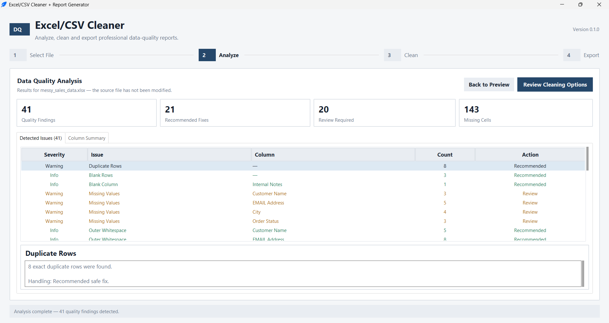
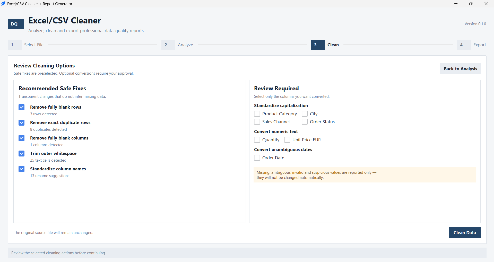

# Excel/CSV Cleaner + Report Generator

A desktop application for finding common spreadsheet problems, cleaning data with transparent rules, and producing a professional Excel report.

The application runs locally on your computer. It does not upload data, use cloud services, or overwrite the original file.

## What it does

Select a `.xlsx` or `.csv` file and the application will:

- preview the dataset before making changes;
- analyze common data-quality problems;
- separate safe fixes from decisions that require review;
- clean a copy of the data using the options you approve;
- show a before-and-after summary;
- export a formatted Excel report and, optionally, a cleaned CSV.

The analyzer detects:

- exact duplicate rows;
- fully blank rows and columns;
- missing values by column;
- leading and trailing whitespace;
- inconsistent column names;
- capitalization variants;
- numeric values stored as text;
- invalid or suspicious numeric values;
- mixed, ambiguous, or invalid date values;
- negative values and potential numeric outliers.

## How it works

The interface follows four steps:

1. **Select File** — load an Excel workbook or CSV and inspect a data preview.
2. **Analyze Data** — review quality metrics, detected issues, affected columns, and full issue details.
3. **Clean Data** — accept the recommended safe fixes and choose any optional column conversions.
4. **Export Results** — save the cleaned dataset, quality summary, cleaning log, and useful charts(Charts-DemoFeature).

The original source file is never modified. All cleaning is performed on an in-memory copy.

## Conservative cleaning policy

The application avoids guesses that could corrupt client data.

### Recommended safe fixes

These options are selected by default:

- remove fully blank rows;
- remove exact duplicate rows;
- remove fully blank columns;
- trim leading and trailing whitespace;
- standardize column names to readable `snake_case`.

### User-approved changes

These changes are applied only to columns selected by the user:

- standardize capitalization using a unique most-common variant;
- convert unambiguous numeric text to numbers;
- convert recognized, unambiguous date text to dates.

Missing values, ambiguous dates, invalid values, tied capitalization variants, negative numbers, and statistical outliers are reported but not silently changed.

## Excel report

The exported workbook contains:

1. **Cleaned Data** — the cleaned dataset in a filterable Excel table.
2. **Data Quality Summary** — before-and-after quality metrics.
3. **Cleaning Log** — an auditable record of every applied operation.
4. **Charts** — missing-value and category charts when the data makes them meaningful.

The workbook includes styled headers, frozen panes, readable column widths, date formatting, and color-coded summary results.

An optional UTF-8 CSV export contains only the cleaned dataset.

## Screenshots





## Quick start

### Requirements

- Python 3.12 or newer
- Windows 10 or Windows 11

### Installation

```powershell
git clone <repository-url>
cd excel-csv-cleaner

py -3.12 -m venv .venv
.venv\Scripts\activate
python -m pip install -r requirements.txt
```

### Run the application

```powershell
python main.py
```

Use `sample_data/messy_sales_data.xlsx` to try the complete workflow.

## Demo dataset

The repository includes synthetic sales data created specifically for this project. It contains realistic duplicates, missing values, blank structures, whitespace, capitalization variants, mixed date formats, and numeric values stored as text.

No private, client, or university research data is included.

To rebuild the demo files:

```powershell
python scripts\generate_demo_data.py
```

To regenerate the example Excel and CSV outputs:

```powershell
python scripts\generate_example_outputs.py
```

## Project structure

```text
excel-csv-cleaner/
├── main.py                         # Application entry point
├── cleaner_app/
│   ├── analysis.py                 # Non-destructive quality analysis
│   ├── cleaning.py                 # Conservative cleaning operations
│   ├── file_io.py                  # Excel and CSV loading
│   ├── gui.py                      # Desktop workflow and interface
│   ├── models.py                   # Shared result and issue models
│   ├── reporting.py                # Excel/CSV report generation
│   └── styles.py                   # GUI styling
├── sample_data/                    # Synthetic messy demo files
├── output/                         # Example cleaned deliverables
├── screenshots/                    # Portfolio images
├── scripts/                        # Demo-data and output generators
├── tests/                          # Automated test suite
├── requirements.txt
└── README.md
```

## Tests

The project includes 53 automated tests covering file loading, dataset analysis, conservative cleaning, report contents, workbook formatting, charts, and CSV export.

Run the full suite with:

```powershell
python -m unittest discover -s tests -v
```

## Technology

- Python
- pandas
- openpyxl
- Tkinter with ttkbootstrap
- tksheet

## Current limitations

- Supported input formats are `.xlsx` and `.csv`.
- The first worksheet is loaded from an Excel workbook.
- The application does not infer or fill missing values.
- Suspicious values are flagged for review instead of being automatically corrected.
- Processing is local and intended for small to medium spreadsheet datasets.

## License

This project is available under the MIT License.
